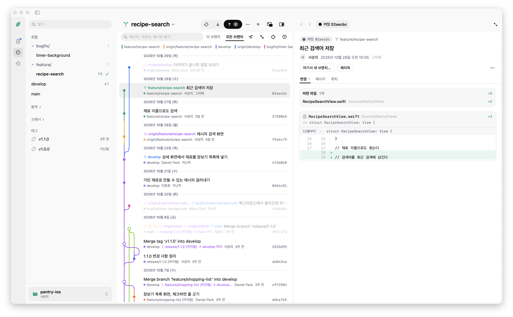
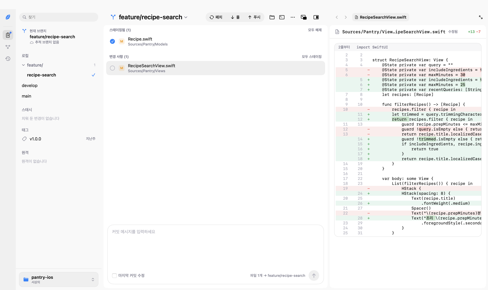
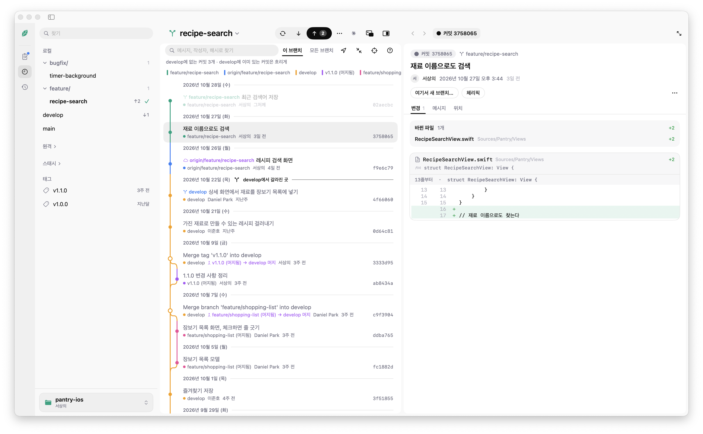
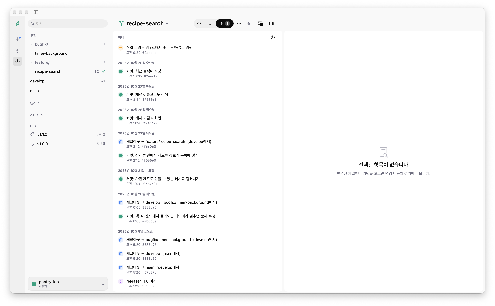
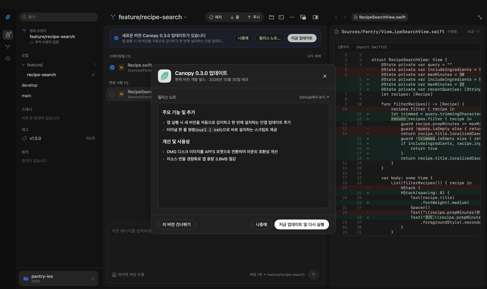

<div align="center">


# Canopy

**브랜치와 워크트리 전체를 위에서 내려다보며 작업하는 macOS 네이티브 Git 클라이언트**

[](https://github.com/sangeui/Canopy/releases/latest)
[](https://github.com/sangeui/Canopy/releases/latest)
[](Package.swift)
[](https://github.com/sangeui/Canopy/releases/latest)
[](LICENSE)

[**설치하기**](#설치-및-업데이트) · [**핵심 특징**](#핵심-특징) · [**주요 화면**](#주요-화면) · [**단축키**](#단축키) · [**보안**](#보안-모델) · [**개발 안내**](#개발-및-구조) · [**라이선스**](#라이선스)

</div>

<br />



Canopy는 복잡한 브랜치 흐름과 여러 워크트리를 다루는 개발자를 위한 macOS 전용 Git 클라이언트입니다. 무거운 웹 뷰나 별도 Git 라이브러리 대신 **SwiftUI + AppKit(`NSTextView`)** 네이티브 화면과 macOS 기본 **`/usr/bin/git`** 프로세스를 직접 구동하여, 수만 개의 커밋과 수천 줄의 diff도 지연 없이 다룹니다.

---

## 설치 및 업데이트

macOS 14(Sonoma) 이상에서 **Apple Silicon**과 **Intel** 맥 모두 네이티브(Universal Binary)로 동작합니다.

### 1. 터미널 한 줄 설치 (권장)

최신 릴리즈 DMG 다운로드, SHA-256 무결성 검증, `/Applications/Canopy.app` 설치, Gatekeeper 격리 속성(`xattr -cr`) 해제를 한 번에 처리합니다.

```bash
curl -fsSL https://raw.githubusercontent.com/sangeui/Canopy/main/scripts/install.sh | zsh
```

### 2. DMG 파일로 설치

1. [**GitHub Releases**](https://github.com/sangeui/Canopy/releases/latest)에서 최신 `Canopy-버전.dmg`를 받아 **Applications** 폴더로 끌어다 놓습니다.
2. 공증되지 않은 빌드를 처음 열 때 Gatekeeper 경고가 뜨면 `시스템 설정 › 개인정보 보호 및 보안`에서 **"그래도 열기"** 를 누르거나 아래 명령을 실행합니다.

```bash
xattr -cr /Applications/Canopy.app
```

### 3. 앱 내 자동 업데이트

이미 앱을 설치한 사용자는 실행할 때마다 새 버전을 자동으로 안내받습니다.

- **자동 감지**: 새 릴리즈가 올라오면 앱 상단 배너로 즉시 알려 줍니다.
- **릴리즈 노트 및 원클릭 업데이트**: 배너나 **`Canopy › 업데이트 확인…`** 메뉴에서 변경 내역을 읽고, **`지금 업데이트 및 다시 실행`** 버튼 하나로 다운로드·검증·교체·재실행까지 마칩니다.

---

## 핵심 특징

| 기능 | 설명 |
| :--- | :--- |
| **브랜치 중심 그래프** | 커밋마다 소속 브랜치를 먼저 계산해 같은 브랜치는 항상 같은 열과 색으로 그립니다. |
| **선언 & 낱말 단위 Diff** | 줄 번호 대신 `func layout · var height`처럼 바뀐 선언 이름을 보여 주고, 실제로 바뀐 단어만 강조합니다. |
| **0.05초 Git 실행 취소 (`⌘Z`)** | 커밋, 파일·줄 버리기, 체크아웃, 머지, 리베이스, 스태시, 브랜치 삭제를 `⌘Z` / `⇧⌘Z`로 되돌립니다. |
| **합치기 전 충돌 미리보기** | 머지·리베이스·풀을 실행하기 전에 `git merge-tree`로 충돌 파일 수와 충돌 구간을 미리 계산합니다. |
| **내장 Claude Code · Antigravity (`⌘I`)** | Claude와 Antigravity CLI 중 원하는 엔진을 골라 diff·커밋·브랜치 비교를 문맥으로 첨부하고 설명, 코드 리뷰, 커밋 메시지 제안을 받습니다. |
| **미니 플레이어 (`⌥⌘M`) & 빠른 실행 (`⌘P`)** | 폭 360pt의 작은 창으로 스테이징·커밋·동기화를 처리하고, `⌘P`로 모든 동작과 브랜치를 즉시 실행합니다. |

---

## 주요 화면

### 1. 변경 사항과 선언·낱말 단위 Diff (`⌘1`)

수천 줄짜리 diff도 네이티브 `NSTextView`로 즉시 열리며, 줄 단위로 드래그해 부분 스테이징하거나 버릴 수 있습니다.



- **선언 머리말 표시**: 파일과 hunk 머리말에 `func layout · var height`, `33줄부터 · class Banner`처럼 바뀐 선언 이름을 적어 코드 맥락을 바로 파악합니다.
- **바뀐 낱말 강조**: 삭제된 줄과 추가된 줄을 짝지어 실제로 바뀐 단어만 진하게 칠합니다.
- **드래그 줄 선택 패치**: diff에서 원하는 줄만 드래그하면 **`N줄 · 고른 줄 스테이징 · 고른 줄 버리기`** 버튼이 나타나 선택한 줄만 적용합니다.
- **빠른 키보드 조작**: 파일 목록에서 `⏎`(스테이징/해제), `Space`(개별 토글), `⌫`(버리기), `⌘A`(묶음 전체 선택)로 손떼지 않고 정리합니다.
- **파일 히스토리 & Blame**: 파일이나 diff 머리말을 우클릭하면 이름 변경 이력까지 추적하는 **파일 히스토리**와 **줄별 작성자(blame)** 를 바로 엽니다.

---

### 2. 브랜치 중심 히스토리 그래프 (`⌘2`)

알 수 없는 지그재그 선 대신 **선 하나가 곧 브랜치 하나**가 되도록 소속을 먼저 계산해 그립니다.



- **명확한 브랜치 소속**: 기준 브랜치(`develop`, `main`, 원격 `HEAD`)를 먼저 배정하고 첫 번째 부모(`first-parent`)를 따라 내려가며 소속을 정합니다.
- **말로 풀어 쓴 머지 & 조상 강조**: 머지 커밋은 `feature/login → main 머지`처럼 풀어 적고, 커밋을 고르면 그 커밋의 조상만 밝게 남깁니다.
- **3단계 범위 필터와 구조만 보기**:
  - **이 브랜치 작업 (기본)**: 기준 브랜치 이후 내가 쌓은 커밋만 보여 줍니다.
  - **이 브랜치 전체 / 모든 브랜치**: 분기 이전 커밋이나 저장소 전체 브랜치를 조망합니다.
  - **구조만 보기**: 분기·병합 지점만 남기고 평범한 연속 커밋은 `커밋 n개` 한 줄로 접습니다.
- **브랜치 비교와 충돌 미리보기**: 사이드바에서 브랜치를 고르면 기준 브랜치 대비 `↑앞섬 ↓뒤처짐`과 **`충돌 N개` / `충돌 없음`** 배지를 즉시 보여 줍니다.
- **생명주기 배지**: 이미 병합된 브랜치에는 `머지됨`, 커밋이 없는 브랜치에는 `작업 없음`, 원격이 사라진 브랜치에는 `원격 없음`을 흐리게 표시합니다.

---

### 3. 우리말 활동 타임라인 (`⌘3`) & `⌘Z` 실행 취소

복잡한 `git reflog`를 읽기 쉬운 타임라인으로 풀어 보여 주고, 모든 주요 Git 작업을 `⌘Z`로 안전하게 되돌립니다.



- **Reflog 우리말 변환**: `체크아웃 → main (feature/login에서)`, `커밋: …`, `feature/login 머지`처럼 작업 이력을 시간순으로 보여 줍니다.
- **삭제한 브랜치 복구**: 앱에서 지운 로컬·원격 브랜치는 상단 **`최근 지운 브랜치`** 에 남아 버튼 하나로 즉시 되살립니다.
- **작업 트리를 지키는 `⌘Z` / `⇧⌘Z`**:
  - 커밋, 수정(amend), 파일·줄 버리기, 체크아웃, 머지·리베이스·체리픽·리버트, 리셋, 풀, 스태시, 브랜치·태그 작업을 모두 되돌립니다.
  - 워크트리별 캐시 스냅샷으로 0.05~0.15초 만에 상태를 기록하며, **그 작업이 바꾼 파일만 복원**하므로 이후에 수정한 다른 파일은 건드리지 않습니다.

---

### 4. 다크 모드, 10가지 테마 & 내장 도우미

시스템 연동 라이트·다크 모드와 10가지 테마(ChatGPT, Claude 크림 테마 포함)를 지원합니다.



- **내장 Claude Code · Antigravity (`⌘I`)**: 창 오른쪽 아래에 떠 있는 카드로 동작하며, 설정(`⌘,`)이나 카드 상단에서 **Claude**와 **Antigravity (`agy` / `gemini`)** 중 원하는 엔진을 바로 전환할 수 있습니다. 보고 있는 파일·커밋·브랜치 비교가 문맥 칩으로 자동 첨부되며, `/`를 입력해 로컬 스킬(`.claude/skills`, `.agents/skills`, `.gemini/skills`)을 자동완성합니다.
- **미니 플레이어 모드 (`⌥⌘M`)**: 메인 창을 숨기고 폭 360pt의 작은 창 하나만 띄워 브랜치 상태 확인, 페치·풀·푸시, 스테이징과 한 줄 커밋을 처리합니다.
- **빠른 실행 (`⌘P`)**: 몇 글자만 입력해 모든 Git 동작, 브랜치 체크아웃, 태그, 최근 저장소를 찾아 엔터로 실행합니다.

<details>
<summary><strong>워크트리, 사이드바 고정(Pin), 동기화 및 확인 창 상세 설명 보기</strong></summary>

- **워크트리 전환 및 관리**: 워크트리 안의 어느 하위 폴더를 열어도 메인 저장소를 찾아 연결하며, 사이드바에서 워크트리를 전환하거나 추가·제거합니다.
- **사이드바 고정(Pin)과 별명(Alias)**: 자주 쓰는 브랜치, 원격 브랜치, 태그, 스태시, 워크트리를 사이드바 맨 위 **고정** 섹션에 모아 두고, 브랜치마다 별명을 붙여 원래 이름 옆에 함께 표시합니다.
- **접을 수 있는 패널과 경로 탐색**: 왼쪽 사이드바(`⌃⌘S`)와 오른쪽 상세 패널(`⇧⌘D`)을 접을 수 있고, 오른쪽 패널 상단 경로(Breadcrumb)를 통해 열어 본 커밋과 파일을 `⌘[` / `⌘]`로 오갑니다.
- **안전한 풀/푸시 시트**: 시스템 credential helper와 `ssh-agent`를 그대로 쓰며, 마지막 페치 기준으로 보낼 커밋 수와 원격 저장소 전체 이름을 명확히 보여 줍니다. 강제 푸시(`--force-with-lease`)를 켜면 버튼이 빨개지고 실수로 `⏎`를 눌러도 실행되지 않습니다.
- **결과 중심 확인 창**: 모든 확인 창은 **제목(동작)** · **대상(고정폭 전체 이름)** · **결과(남는 것 / 사라지는 것 / 알아 둘 것)** 세 칸으로 구성되어, 삭제나 리셋 전에 잃게 되는 커밋 수를 정확히 알려 줍니다.
- **터미널 연동 (`⌃⌘T`)**: 기본 터미널, Ghostty, iTerm, Warp, WezTerm, kitty, Alacritty 중 설치된 앱으로 저장소 폴더를 바로 엽니다.

</details>

---

## 단축키

Fork 2.70의 메뉴 단축키 체계를 따르며, Canopy 전용 단축키를 더했습니다.

### 화면 및 탐색

| 단축키 | 동작 | 단축키 | 동작 |
| :--- | :--- | :--- | :--- |
| `⌘1` / `⌘2` / `⌘3` | 변경 사항 / 히스토리 / 활동 전환 | `⌘P` | 빠른 실행 (Quick Launch) |
| `⌥⌘M` | 미니 플레이어 모드 전환 | `⌘I` | 어시스턴트(Claude · Antigravity) 열기·닫기 |
| `⌃⌘S` / `⇧⌘D` | 사이드바 / 오른쪽 패널 접기·펼치기 | `⌘[` / `⌘]` | 상세 패널 뒤로 / 앞으로 |
| `⌘0` / `⌘F` / `⇧⌘A` | `HEAD` 이동 / 커밋 찾기 / 현재 브랜치만 | `⌥⌘1` · `2` · `3` | 커밋 상세 탭 (메시지 / 변경 / 위치) |

### Git 작업 및 도구

| 단축키 | 동작 | 단축키 | 동작 |
| :--- | :--- | :--- | :--- |
| `⏎` / `Space` / `⌫` | 스테이징·해제 / 개별 토글 / 버리기 | `⌘A` | 현재 묶음 전체 선택 |
| `⇧⌘C` | 커밋 메시지 입력 칸으로 이동 | `⌘↩` / `⇧⌘↩` | 커밋 / 커밋하고 푸시 |
| `⇧⌘F` / `⇧⌘L` / `⇧⌘P` | 페치 / 풀 / 푸시 | `⌘B` / `⇧⌘B` / `⇧⌘G` | 체크아웃 / 새 브랜치 / 새 태그 |
| `⇧⌘H` / `⌥⇧⌘H` | 스태시 시트 / 바로 스태시 | `⌘Z` / `⇧⌘Z` | Git 작업 실행 취소 / 다시 실행 |
| `⌃⌘O` / `⌃⌘T` | Finder에서 열기 / 터미널에서 열기 | `⌘R` / `⌘,` | 새로고침 / 설정 열기 |

---

## 보안 모델

신뢰하지 않은 외부 저장소를 열 때도 임의 코드가 실행되지 않도록 기본 격리 원칙을 적용합니다.

1. **위험 설정 상시 차단**: 저장소에 설정된 `core.fsmonitor`, `diff.external`, `textconv` 명령은 어떤 경우에도 실행하지 않습니다.
2. **외부 실행 명령 신뢰 확인**: 머지 드라이버, 필터, Git 훅이 있는 저장소는 처음 열 때 신뢰 여부를 묻고, 설정이 바뀌면 다시 묻습니다.
3. **어시스턴트 최소 권한 격리**: 평소 Claude · Antigravity 호출 시 읽기 전용 모드(`Read·Grep·Glob` 및 `--approval-mode plan` / `--sandbox`)로 구동하며, 저장소의 `.claude` · `.agents` · `.gemini` 설정과 스킬은 신뢰한 저장소에서만 활성화합니다.
4. **원격 리소스 차단**: 커밋 본문과 Claude 답변의 원격 이미지는 사용자가 눌러야만 받으며, 설정(`⌘, › 보안`)에서 신뢰 목록을 언제든 철회할 수 있습니다.

---

## 개발 및 구조

### 소스에서 빌드 및 실행

```bash
# 릴리즈 앱 번들을 빌드해 /Applications에 설치하고 실행
./make-app.sh --install

# CLI에서 바로 실행
swift run Canopy /path/to/repo

# 전체 단위 및 통합 테스트 실행
swift test
```

새 버전 패키징과 GitHub Releases 배포 절차는 [`docs/RELEASING.md`](docs/RELEASING.md)에 정리되어 있습니다.

### 주요 디렉터리 구조

- [`Sources/Canopy/Git/`](Sources/Canopy/Git): `GitRunner`(프로세스 실행), `GitRepository`(Git 명령 묶음), `CommitGraph`(브랜치 그래프 계산), `DirectoryWatcher`(`FSEvents` 감시), porcelain 및 diff 파서
- [`Sources/Canopy/State/`](Sources/Canopy/State): `RepositoryStore`(저장소 상태 및 `⌘Z` 실행 취소 엔진), `AppUpdater`(자동 업데이트 및 무결성 검증 설치), 테마 및 터미널 연동
- [`Sources/Canopy/Views/`](Sources/Canopy/Views): SwiftUI 화면 및 `NSTextView` 기반 Diff·마크다운 렌더러
- [`Tests/CanopyTests/`](Tests/CanopyTests): 파서 단위 테스트 및 실제 임시 Git 저장소 기반 통합 테스트

---

## 라이선스

이 프로젝트는 [**MIT License**](LICENSE)에 따라 배포됩니다. Copyright (c) 2026 Sangeui Seo.
